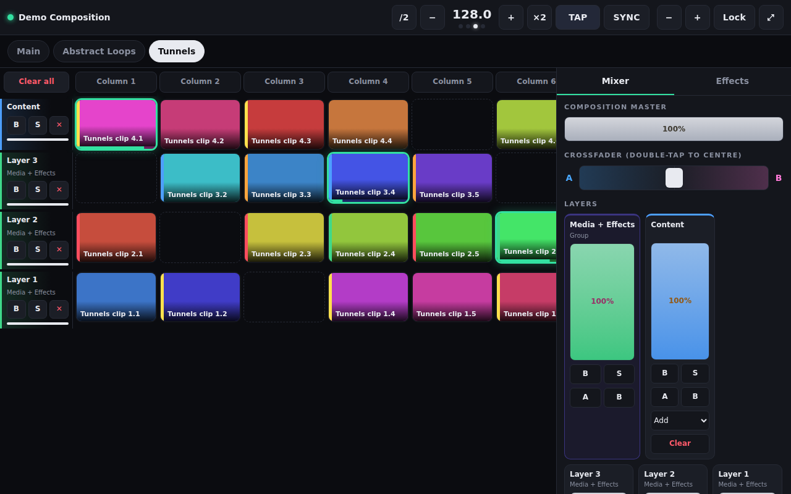
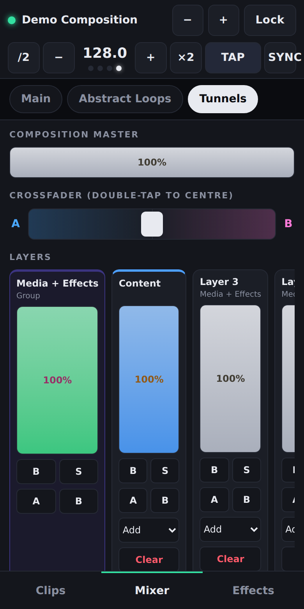

# Arena Touch

A touch control surface that lets you run **Resolume Arena** from any phone or tablet browser.

Arena Touch talks directly to Resolume's built-in REST and WebSocket API, so it needs no OSC mapping, no MIDI and no layout building. It reads the composition that is loaded and builds the clip grid, mixer and effects controls from it. When you switch decks or change something in Arena, every connected device updates.



> The screenshots use demo data from the included mock server. With a real composition you see your own clip thumbnails and names.

## Features

- **Decks:** tap to switch, and the grid rebuilds from the new deck.
- **Clip grid:** real thumbnails and live state (green means playing, amber means previewing). Arena colour labels show as a stripe on each clip, and playing clips show a progress bar for their loop. Column triggers, per-layer bypass, solo and clear, plus Clear all. **Lock** stops accidental triggers, and tile size is adjustable.
- **Column pages:** show 4, 6, 8, 10, 12 or 16 columns at a time (8 by default, matching an APC Mini) or all of them, with page arrows and dots. This makes big decks usable on a phone.
- **Clip panel:** follows the selected clip, whether you selected it in Arena or it's the last clip triggered from the app. It has scrub position (with time), speed, direction, play mode, opacity, blend mode, resize, transport type, trigger style, beat snap, and the clip's own effects. Selected clips show an amber dot in the grid.
- **Mixer:** composition master, A/B crossfader (double-tap to centre), and a strip for each layer and group: master fader, bypass, solo, crossfader A/B assignment, blend mode and clear. Faders move relative to your finger, so they never jump when touched.
- **Effects:** every video effect on the composition, a group or a layer, each with an on/off toggle and all of its parameters (sliders, toggles, dropdowns, colours, hold buttons and steppers).
- **Blackout:** one tap takes every layer, group and the composition to 0, so the wall goes black even when Advanced Output slices take their input from groups or layers. Clips keep playing. Tap **Restore** to bring back the exact levels. Every connected device shows the blackout.
- **Output preview:** a live snapshot of the composition, Preview, busses or any single group or layer, refreshed about five times a second (needs a Resolume version with snapshot support).
- **Tempo:** live BPM with a beat pulse and a four-dot bar counter, plus TAP, SYNC, ±1, /2 and ×2.
- **Multi-device:** connect as many phones and tablets as you like. Everything stays in sync both ways, including with Arena and your MIDI controller.
- **Responsive:** a side-by-side layout on tablets, and bottom tabs on phones.
- **Stays awake:** the phone or tablet screen won't sleep while the app is open, even over plain `http://` on your LAN. Browsers refuse the Wake Lock API there, so it falls back to a tiny silent looping video.

<p align="center"></p>

## Requirements

- Resolume Arena 7.x with the webserver enabled (see Quick start below). Avenue should also work, but hasn't been tested.
- Python 3.8 or newer on the computer running Resolume. Only the standard library is used, so there is nothing to `pip install`.
- A phone or tablet on the same network as that computer.

## Quick start

1. In Resolume: **Preferences → Webserver**, turn it on and keep the port at **8080**.
2. Download this repo (**Code → Download ZIP**) or `git clone` it onto the Resolume machine.
3. Start the server:
   - **Windows:** double-click `start-windows.bat`
   - **macOS:** double-click `start-mac.command`, or run `python3 server.py`
4. The console prints the address to use, for example:
   ```
   On tablet/phone:  http://192.168.1.23:8000
   ```
   Open that address in the browser on your phone or tablet.
5. The first time you run it on Windows, allow Python through the firewall on **Private** networks.

Tip: use *Add to Home Screen* (iOS Safari) or *Install app* (Android Chrome) to run it full-screen.

### Options

```
python3 server.py --port 8000 --resolume 127.0.0.1:8080 --bind 0.0.0.0
```

## Configuration

`web/config.js` holds the settings: the starting number of columns per page, and the colour labels. Resolume's API reports only a colour **number** (1–6) for clips, layers, groups and decks, not the actual colour. The numbers are mapped to colours in that file, so edit the hex values if the colours don't match your Arena setup.

## How it works

```
phone/tablet ──Wi-Fi──► server.py :8000 ──► Resolume webserver 127.0.0.1:8080
                        serves web/ and relays /api/* (REST, thumbnails, WebSocket)
```

The relay means devices need to reach only one port, and it avoids the browser's cross-origin restrictions. The web app is plain HTML, CSS and JavaScript with no build step. It uses the same WebSocket protocol as Resolume's own example app at `http://localhost:8080/api/docs/example/`:

| Message | Purpose |
|---|---|
| *(on connect)* full composition JSON | builds the UI; it is sent again when the structure changes |
| `{action:"subscribe", parameter:"/parameter/by-id/<id>"}` | live updates for the controls you can see |
| `{action:"set", parameter:"/parameter/by-id/<id>", value}` | faders, toggles and choices (choices by index) |
| `{action:"trigger", parameter:"/composition/clips/by-id/<id>/connect", value:true\|false}` | press and release for clips and columns |
| `{action:"trigger", parameter:"/composition/decks/by-id/<id>/select"}` | deck switch |

**About the beat pulse:** the API shares the BPM but not the beat position. The pulse runs on the device's own clock at the live BPM. TAP snaps it to the beat and SYNC restarts the bar, both here and in Resolume, so one press of SYNC realigns everything.

## Development

You don't need Resolume to work on the UI. There's a mock server that serves a fake composition:

```
pip install websockets
python3 dev/mock_resolume.py     # fake Resolume on :8080
python3 server.py                # open http://localhost:8000
```

Edit the files in `web/` and reload the page to see changes.

### Project layout

```
server.py              relay and static file server (stdlib only)
web/index.html         page shell
web/app.js             app: WebSocket client, param store, grid, mixer, effects, tempo
web/app.css            styles
web/config.js          user settings (colour labels)
dev/mock_resolume.py   fake Resolume for development
start-windows.bat      Windows launcher
start-mac.command      macOS launcher
```

## Limitations

Resolume's API covers the composition only. Outputs, screens, slices and Advanced Output presets can't be read or changed by any web app. Because slices take their input from layers and groups, you can still control what reaches each part of a screen by bypassing or fading the layer or group that feeds it.

## Roadmap

- Autopilot controls
- Hiding layers and columns, and a performance mode (big tiles only)
- Sync grid pages with an APC Mini page (MIDI)
- QR code to connect, clip time-remaining countdown, PIN lock
- Per-slice-source "panel" buttons (e.g. blank the side screens only)

Issues and pull requests are welcome.

## Disclaimer

Arena Touch is an independent, community project. It is not affiliated with or endorsed by Resolume. "Resolume", "Arena" and "Avenue" are trademarks of their respective owners.

## Licence

[MIT](LICENSE) © 2026 Dhillan Kalyan
